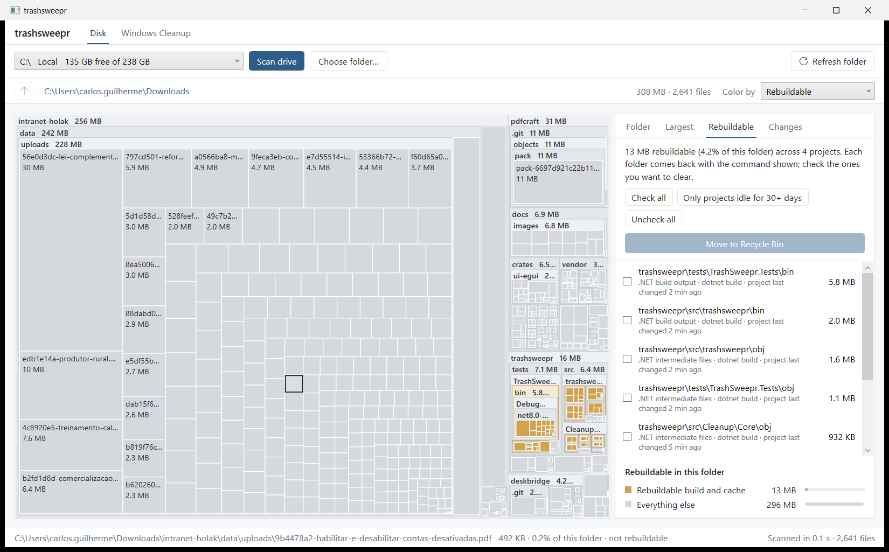
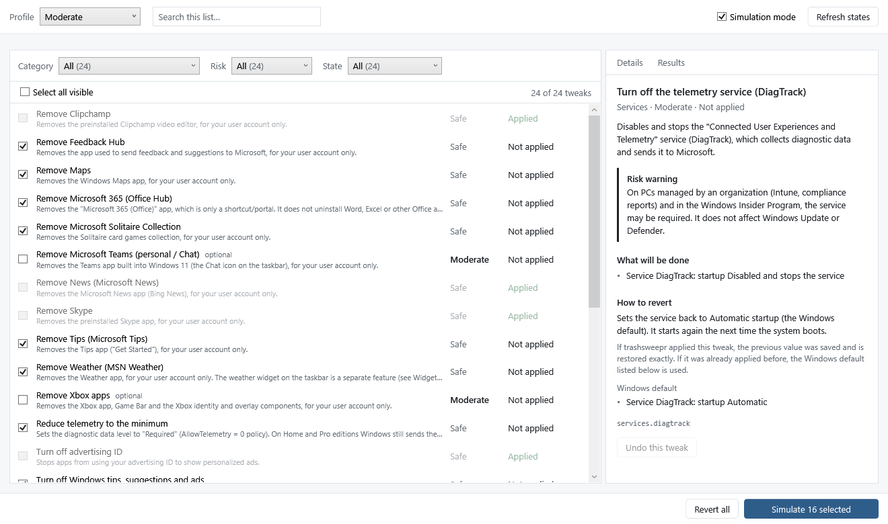

# trashsweepr

[Leia em português](README.md)

A Windows app that answers two questions: **"what is filling up my disk?"** and **"how do I trim the excess out of
Windows 11 without breaking anything?"**.



## Why another disk analyzer

The analyzers I know show colored blocks and stop there. You find out a folder is 40 GB, but not whether it's safe
to delete. trashsweepr tries to answer that: it recognizes `node_modules`, `target`, `bin/obj`, `.venv` and friends,
checks that the project really sits right next to them, and tells you which command brings everything back.
It also remembers previous scans, so you can see what grew since last week.

And since cleaning the disk and cleaning Windows go hand in hand, the app has a second section for removing
preinstalled apps, telemetry and ads, always with simulation, backups and an undo button.

## Download

Grab the latest `.zip` from [Releases](https://github.com/carlosholak/trashsweepr/releases), extract it and open
`trashsweepr.exe`. It needs the [.NET 8 Desktop Runtime](https://dotnet.microsoft.com/download/dotnet/8.0)
(Windows offers to download it if it's missing). Keep the `tweaks` folder next to the `.exe`.

You can also open it from the command line:

```
trashsweepr.exe [folder] [--tab recoverable|changes|largest] [--cleanup]
```

Passing a folder starts scanning it right away (dropping a folder onto the `.exe` does the same), and `--cleanup`
opens straight into the second section.

### Language

The app shows up in Portuguese when Windows is in Portuguese, and in English for any other language. There's no
setting to switch: it follows the Windows display language (Settings > Time & language > Language & region).

## Disk

Click **Scan drive** or **Choose folder…** and wait for the map to appear. Double-click opens a folder,
**Backspace** (or **Alt+←**) goes back, **F5** rescans just the open folder and **Esc** cancels. The map can be
colored by file type, by age (last modified), by what's rebuildable, or by what changed.

The side panel has four tabs:

- **Folder**: the contents of the open folder, with size and percentage.
- **Largest**: the 200 largest files anywhere below it.
- **Rebuildable**: build and cache folders, the command that recreates them and how long the project has been idle.
  This is where you can send things to the Recycle Bin.
- **Changes**: what appeared, grew, shrank or disappeared since an earlier scan.

### What counts as rebuildable

The rule is simple: a folder is only flagged if the project file is right next to it. A stray `bin` or `build`
in the middle of your documents doesn't count.

| Folder | Needs next to it | How it comes back |
|---|---|---|
| `node_modules`, `.next`, `.nuxt`, `.svelte-kit`, `.turbo`, `.parcel-cache` | `package.json` | `npm install` / `npm run build` |
| `target` | `Cargo.toml` | `cargo build` |
| `bin`, `obj` | `*.csproj`, `*.fsproj` or `*.vbproj` | `dotnet build` |
| `.venv`, `venv` | `pyproject.toml`, `requirements.txt`, `setup.py` or `Pipfile` | `python -m venv` + `pip install` |
| `.gradle`, `build` | `build.gradle(.kts)` or `settings.gradle(.kts)` | `gradlew build` |
| `.dart_tool`, `build` | `pubspec.yaml` | `flutter pub get` / `flutter build` |
| `build` | `CMakeLists.txt` | `cmake --build` |
| `__pycache__`, `.pytest_cache`, `.mypy_cache`, `.ruff_cache` | nothing | they come back on their own |

The global caches of npm, Yarn, pnpm, pip, NuGet, Cargo and Gradle show up too.

Nothing is really deleted: whatever you pick goes to the Windows Recycle Bin after a confirmation, and you can
restore it from there. If something is too big for the Recycle Bin, Windows itself warns you first. And the app only
offers to remove folders it recognized as rebuildable; there's no "delete anything" button.

### How it remembers scans

Every complete scan saves a small summary (folders and files from 1 MB up; about 45 KB for 34 thousand files)
in `%LOCALAPPDATA%\trashsweepr\snapshots`, keeping up to 12 per folder. Smaller files that haven't been modified
since then count as unchanged.

## Windows Cleanup



This is a list of tweaks: removing apps that ship with Windows, turning off telemetry, taking ads out of the Start
menu and the like. Each one says what it does, how risky it is (**Safe**, **Moderate** or **Advanced**) and how to
undo it. When you open the section, the app checks what is already applied on your machine and disables, with the
reason, anything that doesn't fit your version of Windows.

So you don't have to check everything by hand, there are three profiles: **Light** checks only the safe ones,
**Moderate** adds the moderate ones, and **Custom** is you picking item by item. No profile checks the advanced ones,
nor the optional ones (such as removing the Xbox apps or Teams); those only go if you ask for them.

### Taking care of your machine

Messing with Windows is scary, and rightly so. That's why:

- **Simulation is on by default.** It shows exactly what would be done, including the text of the PowerShell commands
  (under "Show commands"), without touching anything. Simulation and the real run use the same plan, so what you see
  is what will happen.
- **Before applying**, the app creates a restore point (and asks whether to go on if System Protection is off) and
  saves the previous value of every key, service, task and app it's about to change.
- **Every change is verified** right after it's made. If part of a tweak fails, the rest of that tweak is undone.
- **Moderate and advanced tweaks** show their risk warning and ask you to confirm you've read it.
- **Undo** works per tweak or all at once, newest first. If a tweak was already applied before the app came along,
  it goes back to the Windows default.
- **Some things are never touched**: Edge, Microsoft Store, Windows Update, Defender, networking, audio and system
  components. That list lives in the code (`CriticalComponents`), not in the catalog, so no JSON file can change it.
- **The catalog carries no scripts.** The JSON files describe actions (registry, service, task, app); the PowerShell
  scripts are fixed in the app, and names go in as validated arguments, never pasted into the command text.

Everything is logged to `%ProgramData%\trashsweepr\limpeza\logs`, and the backups go to
`%ProgramData%\trashsweepr\limpeza\backups`. The folder keeps its old Portuguese name, `limpeza`, so "Undo" can
still find backups made by earlier versions.

The app opens without asking for administrator rights, because the disk map doesn't need them. In Windows Cleanup you
can browse and simulate freely; when it's time to apply or undo, it offers **Reopen as administrator** and comes back
straight to the same section.

**About removing apps:** removal applies to your user only (no `-AllUsers`, no deprovisioning). The package files
usually stay on disk, and "Undo" registers the app again. If Windows has already deleted those files, the app tells
you, and the way back is reinstalling from the Microsoft Store.

### Writing your own tweaks

Tweaks live in `tweaks\*.json` (`apps`, `interface`, `privacy`, `services` and `tasks`), and `tweak.schema.json`
gives you autocomplete in the editor. The texts (`name`, `description`, `riskNote`, `revertNote`) carry both
languages, as `{ "en": "...", "pt-BR": "..." }`. Each tweak needs `id`, `name`, `description`, `category`, `risk`,
`apply` and `revert`; `riskNote` is required for Moderate and Advanced, and there are also `revertNote`,
`requiresReboot`, `optIn`, `minBuild` and `maxBuild`. The available actions:

| `type` | Main fields |
|---|---|
| `registry` | `hive` (`hkcu`/`hklm`), `path`, `name`, `kind` (`dword`/`qword`/`sz`/`expandSz`), `value` and `operation`: `set` (default), `deleteValue` or `deleteKey` (the latter only in `revert`, only under `HKCU\Software\Classes\CLSID\{GUID}`, and only for a key the same tweak's `apply` creates) |
| `service` | `name`, `startType` (`automatic`/`automaticDelayed`/`manual`/`disabled`), `stop` |
| `scheduledTask` | `taskPath`, `taskName`, `enabled` |
| `appx` | `operation` (`remove`/`reinstall`), `packageName` (exact name, no wildcards) |

A tweak with an error, with no `revert`, or that tries to touch something protected is skipped when loading (the
reason goes to the log), and the rest of the catalog keeps working.

## Building it yourself

You need the .NET 8 SDK.

```bash
dotnet build trashsweepr.sln
dotnet test trashsweepr.sln
dotnet publish src/trashsweepr/trashsweepr.csproj -c Release -r win-x64 --self-contained false -p:PublishSingleFile=true -o publish
```

The tests use a fake system, so no real tweak is ever executed. A few environment variables change how things run:

- `TRASHSWEEPR_UI_SNAPSHOT_DIR=<folder>` saves PNGs of the rendered interface.
- `TRASHSWEEPR_READONLY_SMOKE=1` runs detection and simulation on your actual Windows, read-only.
- `TRASHSWEEPR_TEST_CULTURE=en-US` runs the tests in another language (the default is `pt-BR`, whatever the Windows language).
- `TRASHSWEEPR_INTEGRATION=1` tests registry access in a temporary key (`HKCU\Software\CleanupTests`) that is deleted at the end.
- `TRASHSWEEPR_LANG=en-US` (or `pt-BR`) opens the app itself in another language, for testing and screenshots.

To publish a new version: bump `<Version>` in `src/trashsweepr/trashsweepr.csproj`, write its section in
[CHANGELOG.md](CHANGELOG.md) and push the tag (`git tag v1.4.0 && git push origin v1.4.0`). GitHub Actions runs the
tests, builds the `.zip` and creates the release.

### Where things are

- `src/trashsweepr`: the WPF app. The Disk section sits at the root (`Scanner`, `Recoverables`, `Snapshots`,
  `RecycleBin`, `Coloring`, `Squarify`, `TreemapControl`, `MainWindow`) and Windows Cleanup in `Cleanup/`
  (ViewModels and Views). Interface texts are in `Resources/Strings.resx` (English) and `Resources/Strings.pt.resx` (Portuguese).
- `src/Cleanup/Core`: the cleanup engine, with no WPF: catalog and validation, protection list, planning, backup,
  restore and logging. Its messages are in `Resources/Messages.resx` and `Messages.pt.resx`.
- `src/Cleanup/Infrastructure`: what actually talks to Windows (registry, PowerShell, services, tasks, apps, restore points).
- `tweaks`: the JSON catalog, the profiles and the schema.
- `tests`: tests for the engine, the interface and the integration with the fake system.

---

The app used to be called **Mapa de Disco**, and the cleanup part was a separate project, `sweepr`. If you used the
old name, the scans saved in `%LOCALAPPDATA%\MapaDeDisco\snapshots` are copied over the first time trashsweepr opens
(the old folder is left as it is).
