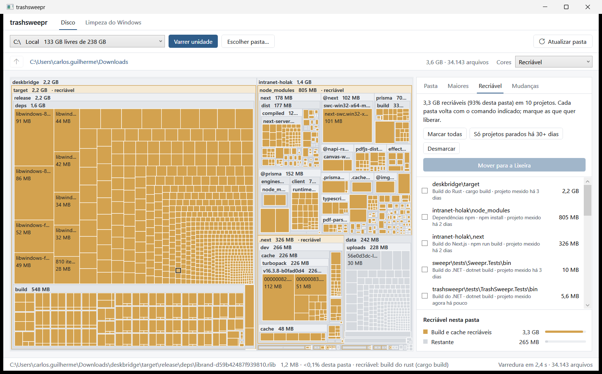

# trashsweepr

[Read in English](README.en.md)

Um app gratuito para Windows que ajuda com duas coisas: **descobrir o que está enchendo o disco** e **tirar o
excesso do Windows 11 sem quebrar nada**.

É um projeto de código aberto, sob a [licença MIT](LICENSE), e foi feito com ajuda de inteligência artificial
(veja [como](#feito-com-ajuda-de-ia)).



## O que ele faz

**Disco.** Mostra o disco como um mapa de blocos, do tamanho de cada pasta e arquivo. A diferença para outros
analisadores é que ele entende o que está vendo: reconhece pastas de build e cache (`node_modules`, `target`,
`bin/obj`, `.venv`...), confere se o projeto está mesmo ali e diz qual comando traz tudo de volta. Também lembra
das varreduras anteriores, então dá para ver o que cresceu desde a semana passada.

**Limpeza do Windows.** Uma lista de ajustes para tirar apps que vêm de fábrica (inclusive Copilot, OneDrive e
Edge), desligar telemetria e anúncios. Cada ajuste explica o que faz e qual o risco, e tudo pode ser simulado antes
e desfeito depois.

## Como começar

1. Baixe o `.zip` mais recente em [Releases](https://github.com/carlosholak/trashsweepr/releases) e extraia numa pasta.
2. Abra o `trashsweepr.exe`. Se faltar o [.NET 8 Desktop Runtime](https://dotnet.microsoft.com/download/dotnet/8.0),
   o próprio Windows oferece o download.
3. Clique em **Varrer unidade**. Pronto.

Deixe a pasta `tweaks` ao lado do `.exe`: é nela que fica a lista de ajustes da Limpeza.

O app aparece em português quando o Windows está em português, e em inglês em qualquer outra língua.

<details>
<summary>Abrir pela linha de comando</summary>

```
trashsweepr.exe [pasta] [--tab recoverable|changes|largest] [--cleanup]
```

Passar uma pasta já começa a varredura (arrastar a pasta sobre o `.exe` faz o mesmo), `--tab` abre numa aba do
painel lateral e `--cleanup` abre direto na Limpeza do Windows. Os nomes antigos (`--aba recriavel|mudancas|maiores`
e `--limpeza`) continuam funcionando.

</details>

## Disco

Escolha uma unidade ou uma pasta e espere o mapa aparecer. Clique duplo entra numa pasta, **Backspace** volta,
**F5** varre de novo só a pasta aberta e **Esc** cancela. As cores podem mostrar o tipo de arquivo, a idade, o que é
recriável ou o que mudou.

O painel ao lado tem quatro abas:

- **Pasta**: o que tem na pasta aberta, com tamanho e percentual.
- **Maiores**: os 200 maiores arquivos de tudo o que está abaixo.
- **Recriável**: pastas de build e cache, o comando que as recria e há quanto tempo o projeto está parado. Daqui
  dá para mandar o que não precisa para a Lixeira.
- **Mudanças**: o que entrou, cresceu, diminuiu ou sumiu desde uma varredura anterior.

Nada é apagado de verdade. O que você escolher vai para a Lixeira do Windows, depois de uma confirmação, e dá para
restaurar de lá. E o app só oferece remover pastas que reconheceu como recriáveis: não existe um botão de "apagar
qualquer coisa".

<details>
<summary>O que conta como recriável</summary>

A pasta só é marcada se o arquivo do projeto estiver ao lado dela. Um `bin` ou `build` solto no meio dos seus
documentos não entra.

| Pasta | Precisa ter ao lado | Como volta |
|---|---|---|
| `node_modules`, `.next`, `.nuxt`, `.svelte-kit`, `.turbo`, `.parcel-cache` | `package.json` | `npm install` / `npm run build` |
| `target` | `Cargo.toml` | `cargo build` |
| `bin`, `obj` | `*.csproj`, `*.fsproj` ou `*.vbproj` | `dotnet build` |
| `.venv`, `venv` | `pyproject.toml`, `requirements.txt`, `setup.py` ou `Pipfile` | `python -m venv` + `pip install` |
| `.gradle`, `build` | `build.gradle(.kts)` ou `settings.gradle(.kts)` | `gradlew build` |
| `.dart_tool`, `build` | `pubspec.yaml` | `flutter pub get` / `flutter build` |
| `build` | `CMakeLists.txt` | `cmake --build` |
| `__pycache__`, `.pytest_cache`, `.mypy_cache`, `.ruff_cache` | nada | voltam sozinhos |

Os caches globais do npm, Yarn, pnpm, pip, NuGet, Cargo e Gradle também aparecem.

</details>

<details>
<summary>Como ele lembra das varreduras</summary>

Cada varredura completa salva um resumo pequeno (pastas e arquivos a partir de 1 MB; uns 45 KB para 34 mil arquivos)
em `%LOCALAPPDATA%\trashsweepr\snapshots`, guardando até 12 por pasta. Arquivos menores que não foram modificados
desde então contam como inalterados.

</details>

## Limpeza do Windows


Cada ajuste mostra o que faz, o risco (**Seguro**, **Moderado** ou **Avançado**) e como desfazer. Ao abrir a seção,
o app confere o que já está aplicado na sua máquina e deixa de fora, explicando o motivo, o que não serve para a sua
versão do Windows.

Para não marcar tudo à mão há perfis: **Leve** marca só os seguros, **Moderado** inclui os moderados e
**Personalizado** é você escolhendo. Os avançados e os opcionais (como remover o Teams, o OneDrive ou o Edge) só vão
se você marcar.

### O cuidado com a sua máquina

Mexer no Windows dá medo, com razão. Por isso:

- **A simulação vem ligada.** Ela mostra exatamente o que seria feito, até o texto dos comandos, sem tocar em nada.
- **Antes de aplicar**, o app cria um ponto de restauração e guarda o valor anterior de tudo o que vai alterar.
- **Cada alteração é conferida** logo depois. Se uma parte falhar, o resto daquele ajuste é desfeito sozinho.
- **Desfazer** funciona por ajuste ou tudo de uma vez.
- **Algumas coisas nunca são tocadas**: Microsoft Store, Windows Update, Defender, rede, áudio, componentes do sistema,
  o WebView2 e o Edge Update. Essa lista fica no código, então nenhum arquivo de ajustes consegue mudar isso.
- **Nada de scripts nos ajustes.** Os ajustes só descrevem o que mudar; os comandos são fixos no app.

O app abre sem pedir administrador, porque o mapa do disco não precisa. Na Limpeza você vê e simula à vontade; na
hora de aplicar, ele oferece **Reabrir como administrador** e volta direto para a mesma tela.

<details>
<summary>Sobre remover apps, OneDrive e Edge</summary>

- **Apps** (Copilot, Clipchamp, Xbox...) saem só para o seu usuário. Os arquivos do pacote costumam continuar no
  disco e o "Desfazer" registra o app de novo; se o Windows já os apagou, é só reinstalar pela Microsoft Store.
- **OneDrive** sai pelo desinstalador oficial que vem com o Windows. Os arquivos que já estão no PC ficam onde estão,
  mas os "somente online" param de abrir até você reinstalar.
- **Edge** sai pelo desinstalador do próprio Edge, num ajuste Avançado. A Microsoft só libera a remoção completa em
  algumas regiões (Espaço Econômico Europeu); nas outras, o Windows recusa e o app avisa que nada foi alterado. O
  "Desfazer" reinstala o Edge pelo winget, com internet.

Tudo fica registrado em `%ProgramData%\trashsweepr\limpeza\logs`, e os backups em `%ProgramData%\trashsweepr\limpeza\backups`.

</details>

## Feito com ajuda de IA

O trashsweepr foi desenvolvido em parceria com o Claude, da Anthropic, usando o Claude Code. Na prática: eu decidi
o que o app deveria fazer, como deveria se comportar e o que era aceitável mexer no Windows; a IA escreveu boa parte do
código, dos testes e dos textos, e eu revisei e aprovei. Nenhum comando que altera o sistema entrou na Limpeza sem ser
explicado e aprovado antes.

Para compensar o risco de um código escrito com IA, o projeto tem mais de 500 testes automáticos, que rodam contra um
Windows falso (nenhum ajuste de verdade é executado nos testes), e o GitHub Actions roda todos eles a cada mudança.
Mesmo assim, use a simulação antes de aplicar, principalmente nos ajustes Moderados e Avançados.

## Código aberto

O código está todo aqui, sob a [licença MIT](LICENSE): dá para usar, estudar, modificar e redistribuir. Encontrou um
problema ou tem uma ideia? Abra uma [issue](https://github.com/carlosholak/trashsweepr/issues). Pull requests também
são bem-vindos.

Como em qualquer software MIT, ele vem sem garantia: é um projeto pessoal, feito com cuidado, mas a responsabilidade
de aplicar os ajustes é de quem usa.

## Para compilar:

(Precisa do SDK do .NET 8)

```bash
dotnet build trashsweepr.sln
dotnet test trashsweepr.sln
dotnet publish src/trashsweepr/trashsweepr.csproj -c Release -r win-x64 --self-contained false -p:PublishSingleFile=true -o publish
```

Para publicar uma versão nova: suba a `<Version>` em `src/trashsweepr/trashsweepr.csproj`, escreva a seção dela no
[CHANGELOG.md](CHANGELOG.md) e envie a tag (`git tag vX.Y.Z && git push origin vX.Y.Z`). O GitHub Actions roda os
testes, gera o `.zip` e cria o release.

<details>
<summary>Variáveis de ambiente para testar</summary>

- `TRASHSWEEPR_UI_SNAPSHOT_DIR=<pasta>` salva PNGs da interface renderizada.
- `TRASHSWEEPR_READONLY_SMOKE=1` roda a detecção e a simulação no seu Windows, só lendo.
- `TRASHSWEEPR_TEST_CULTURE=en-US` roda os testes em outra língua (o padrão é `pt-BR`, seja qual for a do Windows).
- `TRASHSWEEPR_INTEGRATION=1` testa o acesso ao registro numa chave temporária (`HKCU\Software\CleanupTests`), que é apagada no final.
- `TRASHSWEEPR_LANG=en-US` (ou `pt-BR`) abre o próprio app em outra língua, para testar e tirar capturas.

</details>

<details>
<summary>Onde fica cada coisa</summary>

- `src/trashsweepr`: o app WPF. A seção Disco está na raiz (`Scanner`, `Recoverables`, `Snapshots`, `RecycleBin`,
  `Coloring`, `Squarify`, `TreemapControl`, `MainWindow`) e a Limpeza em `Cleanup/` (ViewModels e Views).
  Os textos da interface ficam em `Resources/Strings.resx` (inglês) e `Resources/Strings.pt.resx` (português).
- `src/Cleanup/Core`: o motor da Limpeza, sem WPF: ajustes e validação, lista de proteção, plano, backup, restauração
  e log. As mensagens dele ficam em `Resources/Messages.resx` e `Messages.pt.resx`.
- `src/Cleanup/Infrastructure`: o que fala com o Windows de verdade (registro, PowerShell, serviços, tarefas, apps,
  programas, ponto de restauração).
- `tweaks`: os ajustes em JSON, os perfis e o esquema.
- `tests`: testes do motor, da interface e da integração com o Windows falso.

</details>
