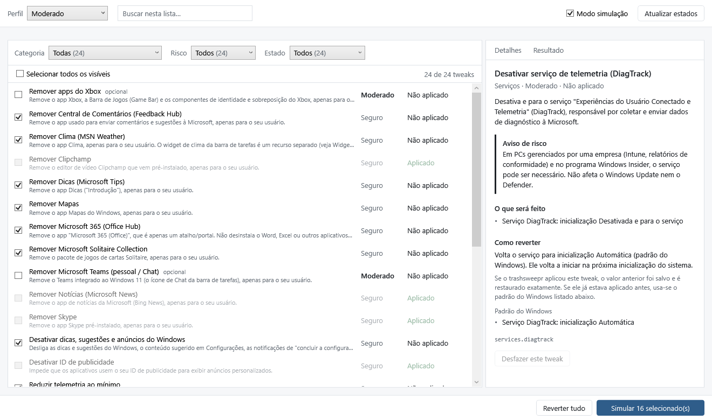

# trashsweepr

Um app para Windows que responde duas perguntas: **"o que está enchendo meu disco?"** e **"como tiro o excesso
do Windows 11 sem quebrar nada?"**.


## Por que mais um analisador de disco

Os analisadores que conheço mostram blocos coloridos e param por aí. Você descobre que uma pasta tem 40 GB,
mas não sabe se pode apagar. O trashsweepr tenta responder isso: ele reconhece `node_modules`, `target`, `bin/obj`,
`.venv` e companhia, confere se o projeto realmente está ali do lado e diz qual comando traz tudo de volta.
Também lembra das varreduras anteriores, então dá para ver o que cresceu desde a semana passada.

E como a limpeza de disco e a limpeza do Windows andam juntas, o app tem uma segunda seção para tirar
apps pré-instalados, telemetria e anúncios, sempre com simulação, backup e botão de desfazer.

## Baixar

Pegue o `.zip` mais recente em [Releases](https://github.com/carlosholak/trashsweepr/releases), extraia e abra o
`trashsweepr.exe`. Precisa do [.NET 8 Desktop Runtime](https://dotnet.microsoft.com/download/dotnet/8.0)
(o Windows oferece o download se ele faltar). Deixe a pasta `tweaks` ao lado do `.exe`.

Também dá para abrir pela linha de comando:

```
trashsweepr.exe [pasta] [--aba recriavel|mudancas|maiores] [--limpeza]
```

Passar uma pasta já começa a varredura (arrastar a pasta sobre o `.exe` faz o mesmo), e `--limpeza` abre direto
na segunda seção.

## Disco

Clique em **Varrer unidade** ou **Escolher pasta…** e espere o mapa aparecer. Clique duplo entra numa pasta,
**Backspace** (ou **Alt+←**) volta, **F5** varre de novo só a pasta aberta e **Esc** cancela. O mapa pode ser
colorido por tipo de arquivo, pela idade (última modificação), pelo que é recriável ou pelo que mudou.

O painel ao lado tem quatro abas:

- **Pasta**: o conteúdo da pasta aberta, com tamanho e percentual.
- **Maiores**: os 200 maiores arquivos de tudo o que está abaixo.
- **Recriável**: pastas de build e cache, o comando que as recria e há quanto tempo o projeto não é mexido.
  É daqui que dá para mandar coisas para a Lixeira.
- **Mudanças**: o que entrou, cresceu, diminuiu ou sumiu desde uma varredura anterior.

### O que conta como recriável

A regra é simples: a pasta só é marcada se o arquivo do projeto estiver ao lado dela. Um `bin` ou `build`
solto no meio dos seus documentos não entra.

| Pasta | Precisa ter ao lado | Como volta |
|---|---|---|
| `node_modules`, `.next`, `.nuxt`, `.svelte-kit`, `.turbo`, `.parcel-cache` | `package.json` | `npm install` / `npm run build` |
| `target` | `Cargo.toml` | `cargo build` |
| `bin`, `obj` | `*.csproj`, `*.fsproj` ou `*.vbproj` | `dotnet build` |
| `.venv`, `venv` | `pyproject.toml`, `requirements.txt`, `setup.py` ou `Pipfile` | `python -m venv` + `pip install` |
| `.gradle`, `build` | `build.gradle(.kts)` ou `settings.gradle(.kts)` | `gradlew build` |
| `.dart_tool`, `build` | `pubspec.yaml` | `flutter pub get` / `flutter build` |
| `build` | `CMakeLists.txt` | `cmake --build` |
| `__pycache__`, `.pytest_cache`, `.mypy_cache`, `.ruff_cache` | nada | voltam sozinhos |

Os caches globais do npm, Yarn, pnpm, pip, NuGet, Cargo e Gradle também aparecem.

Nada é apagado de verdade: o que você escolher vai para a Lixeira do Windows (depois de uma confirmação) e dá para
restaurar de lá. Se algo for grande demais para a Lixeira, o próprio Windows avisa antes, o app só oferece
remover pastas que ele reconheceu como recriáveis; não existe um "apagar qualquer coisa".

### Como ele lembra das varreduras

Cada varredura completa salva um resumo pequeno (pastas e arquivos a partir de 1 MB; uns 45 KB para 34 mil arquivos)
em `%LOCALAPPDATA%\trashsweepr\snapshots`, guardando até 12 por pasta. Arquivos menores que não foram modificados
desde então contam como inalterados.

## Limpeza do Windows



Aqui fica uma lista de ajustes ("tweaks"): remover apps que vêm de fábrica, desligar telemetria, tirar anúncios
do menu Iniciar e coisas do tipo. Cada um diz o que faz, qual o risco (**Seguro**, **Moderado** ou **Avançado**)
e como desfazer. Ao abrir a seção, o app verifica o que já está aplicado na sua máquina e desabilita, explicando
o motivo, o que não serve para a sua versão do Windows.

Para não marcar tudo à mão, há três perfis: **Leve** marca só os seguros, **Moderado** inclui os moderados e
**Personalizado** é você escolhendo item por item. Nenhum perfil marca os avançados, nem os opcionais (como remover
os apps do Xbox ou o Teams); esses só vão se você pedir.

### O cuidado com a sua máquina

Mexer no Windows dá medo, com razão. Por isso:

- **A simulação vem ligada.** Ela mostra exatamente o que seria feito, incluindo o texto dos comandos PowerShell
  (em "Ver comandos"), sem tocar em nada. A simulação e a execução real usam o mesmo plano, então o que você vê é o que vai acontecer.
- **Antes de aplicar**, o app cria um ponto de restauração (e pergunta se você quer seguir caso a Proteção do Sistema
  esteja desligada) e guarda o valor anterior de cada chave, serviço, tarefa e app que vai alterar.
- **Cada alteração é conferida** logo depois. Se uma parte de um ajuste falhar, o resto daquele ajuste é desfeito.
- **Ajustes moderados e avançados** mostram o aviso de risco e pedem que você marque que leu.
- **Desfazer** funciona por ajuste ou tudo de uma vez, do mais recente para o mais antigo. Se o ajuste já estava
  aplicado antes do app existir, ele volta ao padrão do Windows.
- **Algumas coisas nunca são tocadas**: Edge, Microsoft Store, Windows Update, Defender, rede, áudio e componentes do sistema.
  Essa lista fica no código (`CriticalComponents`), não no catálogo, então nenhum JSON consegue mudar isso.
- **O catálogo não carrega scripts.** Os JSON descrevem ações (registro, serviço, tarefa, app); os scripts PowerShell
  são fixos no app e os nomes entram como argumentos validados, nunca colados no texto do comando.

Tudo fica registrado em `%ProgramData%\trashsweepr\limpeza\logs`, e os backups em `%ProgramData%\trashsweepr\limpeza\backups`.

O app abre sem pedir administrador, porque o mapa do disco não precisa. Na Limpeza você pode ver e simular à vontade;
na hora de aplicar ou desfazer, ele oferece **Reabrir como administrador** e volta direto para a mesma seção.

**Sobre remover apps:** a remoção vale só para o seu usuário (nada de `-AllUsers` ou desprovisionar). Os arquivos do
pacote costumam continuar no disco, e o "Desfazer" registra o app de novo. Se o Windows já tiver apagado esses arquivos,
o app avisa e o caminho é reinstalar pela Microsoft Store.

## Para compilar:

(Precisa do SDK do .NET 8)

```bash
dotnet build trashsweepr.sln
dotnet test trashsweepr.sln
dotnet publish src/trashsweepr/trashsweepr.csproj -c Release -r win-x64 --self-contained false -p:PublishSingleFile=true -o publish
```

Os testes usam um sistema falso, então nenhum ajuste de verdade é executado. Três variáveis de ambiente ligam testes extras:

- `TRASHSWEEPR_UI_SNAPSHOT_DIR=<pasta>` salva PNGs da interface renderizada.
- `TRASHSWEEPR_READONLY_SMOKE=1` roda a detecção e a simulação no seu Windows, só lendo.
- `TRASHSWEEPR_INTEGRATION=1` testa o acesso ao registro numa chave temporária (`HKCU\Software\LimpezaTests`), que é apagada no final.

Para publicar uma versão nova: suba a `<Version>` em `src/trashsweepr/trashsweepr.csproj`, escreva a seção dela no
[CHANGELOG.md](CHANGELOG.md) e envie a tag (`git tag v1.3.1 && git push origin v1.3.1`). O GitHub Actions roda os testes,
gera o `.zip` e cria o release.

### Onde fica cada coisa

- `src/trashsweepr`: o app WPF. A seção Disco está na raiz (`Scanner`, `Recoverables`, `Snapshots`, `RecycleBin`,
  `Coloring`, `Squarify`, `TreemapControl`, `MainWindow`) e a Limpeza em `Limpeza/` (ViewModels, Views e os textos em `Resources/Strings.resx`).
- `src/Limpeza/Core`: o motor da Limpeza, sem WPF: catálogo e validação, lista de proteção, plano, backup, restauração e log.
- `src/Limpeza/Infrastructure`: o que fala com o Windows de verdade (registro, PowerShell, serviços, tarefas, apps, ponto de restauração).
- `tweaks`: o catálogo em JSON, os perfis e o esquema.
- `tests`: testes do motor, da interface e da integração com o sistema falso.
